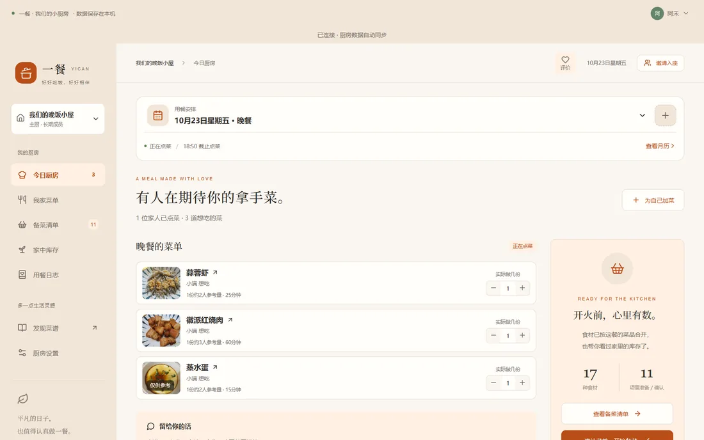
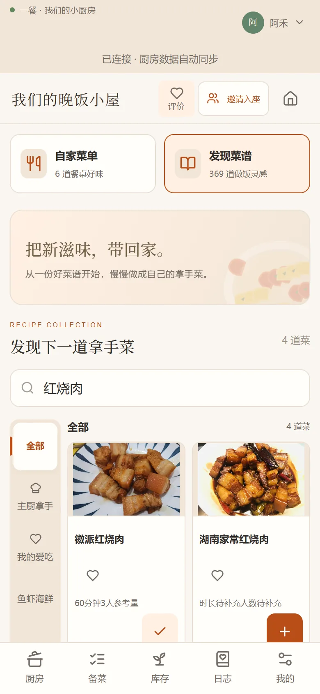
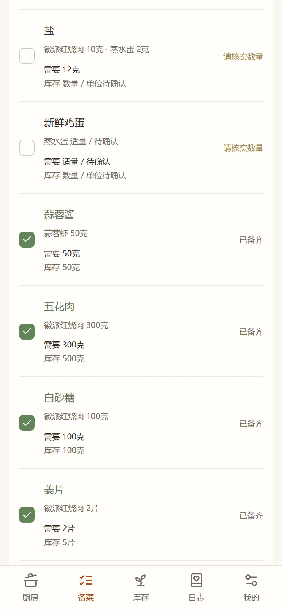
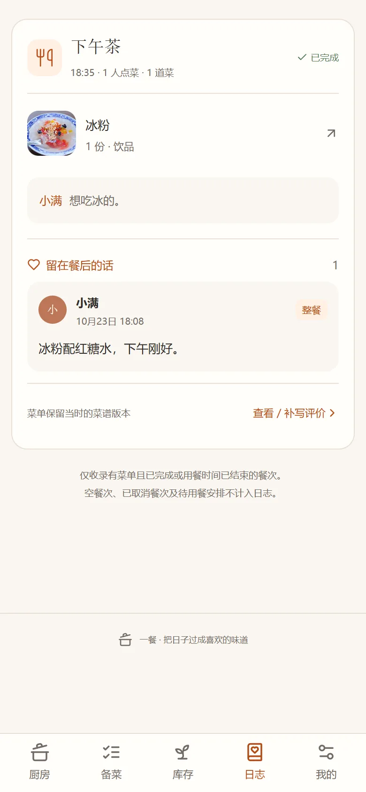

# 一餐

[源码](https://github.com/a92063256/yican-tingtingcook) · [版本发布](https://github.com/a92063256/yican-tingtingcook/releases) · [问题反馈](https://github.com/a92063256/yican-tingtingcook/issues)

在自己电脑上跑的家庭厨房。家里人点菜，你备菜，吃完留一句话。

手机优先，数据存在本机，不需要云服务。内置 369 道菜谱，装好就能用。



## 它是什么

一餐是一个网页，但不挂在互联网上。

它跑在你家那台电脑里。电脑开着，同一个 Wi-Fi 下的手机就能打开；电脑关了，它就停了。账号、菜单、订单、评价都在这台电脑的数据库里，不上传，也不经过任何第三方服务。

所以它适合这样的场景：家里两三个人，或者一起合租的几个人，想有个地方把"今天吃什么"说清楚。

## 能做什么

- **点菜**：主厨开一顿饭，其他人在手机上选，写完提交。主厨那边收到的是合并后的食材，不是三条一样的葱。
- **备菜**：食材按菜合并，和库存对一遍，缺什么一目了然。勾选只表示"备齐了"，不会偷偷扣库存。
- **库存**：可以整段录入，"芹菜一斤，酱油一瓶、鸡蛋十个"直接粘进去。不推断保质期，也不自动扣减。
- **菜谱**：内置 369 道 HowToCook，离线可用。可以加入菜单，也可以另存成自家版本慢慢改。
- **日志**：每顿吃完能留一句话，月历上能看到这个月都吃了什么。

<p align="center">
  
  
  
</p>

## 跑起来

Windows 轻度用户推荐使用便携版：将 `Yican-Windows-x64.zip` 完整解压，双击 `点我启动到局域网.cmd` 即可。已内置运行环境，无需安装 Node、Git 或数据库；同一 Wi-Fi 的手机访问启动窗口打印的地址。仅本机体验使用包内的 `点我启动.cmd`。产物由维护者运行根目录 `build-portable.cmd` 生成在 `release/`，详见 [Windows 便携版说明](docs/Windows便携版使用说明.md)。

从 Git 拉取源码：

```sh
git clone https://github.com/a92063256/yican-tingtingcook.git
cd yican-tingtingcook
```

然后按以下三步运行：

1. 安装 [Node.js 24 LTS](https://nodejs.org/)，一路下一步，装完重启一次电脑。
2. 双击项目里的 `start-lan.cmd`。第一次会自动装依赖、构建页面，需要联网，通常 5—10 分钟。
3. 窗口里会打印一行 `局域网地址：http://192.168.x.x:3000`。手机连同一个 Wi-Fi，打开这个地址。

第一次打开是注册页。注册、建厨房、邀请另一个人，就能开始点菜。

> 只想自己先看看：双击 `start-demo.cmd`，打开 `http://127.0.0.1:5173`。这个模式只在本机，手机连不上。

更细的步骤、界面说明和排错，见 [新手使用指南](docs/新手使用指南.md)。

## 怎么用起来

| 场景 | 入口 | 说明 |
| --- | --- | --- |
| 一个人试试 | `start-demo.cmd` | 只监听本机，改代码会热更新 |
| 家里人一起用 | `start-lan.cmd` | 同一 Wi-Fi 下的手机、平板都能访问 |
| 异地访问 | 自行配置反向代理 | 没有官方方案。服务默认只考虑可信局域网，直接暴露到公网有风险 |

Mac 和 Linux 没有 `.cmd` 脚本，用命令行启动，见 [开发与运行](docs/开发与运行.md)。

## 内置菜谱

369 道菜谱来自 [Anduin2017/HowToCook](https://github.com/Anduin2017/HowToCook)，固定在上游提交 `2b19c9e9ee926fd925a68207a57582a338813f9c`，遵循 Unlicense。菜谱原文没有改写，启动时从项目里离线导入，不联网下载。

封面并不是每一张都精确对应这道菜，界面上会区分：

| 类型 | 数量 | 显示 |
| --- | --- | --- |
| 同菜成品原图 | 173 | 正常显示 |
| 较接近的参考照片 | 11 | 左下角标"仅供参考" |
| 生成插画 | 11 | 标"仅供参考" |
| 待核对的照片 | 2 | 标"仅供参考" |
| 没有合适成品图 | 172 | 显示"实拍待补充" |

菜谱详情底部保留 HowToCook 的来源链接；另存为自家版本后，归属也还在。

## 数据与备份

数据在 `data/kitchen.sqlite`。运行时同目录还会有 `-wal` 和 `-shm` 两个文件，这是 SQLite 的正常工作方式。

备份双击 `backup-lan.cmd`，或者运行 `npm run backup`，会在 `data/backups/` 下生成一个带时间的副本。服务开着也能备份。

> 不要直接复制 `kitchen.sqlite`。SQLite 开了 WAL，最近的记录可能还在 `-wal` 里，只复制主文件会丢数据。

恢复的时候，先停服务，把原来的 `data` 目录改名留好，新建一个空目录，把备份改名成 `kitchen.sqlite` 放进去，再启动。旧的 `-wal`、`-shm` 不要一起放回来。

## 更新

双击 `一键更新.cmd`。需要电脑上装了 Git。

更新会先备份数据库，在独立目录里安装新版本、用数据库副本演练一遍，确认没问题才停服切换；失败会回滚，原来的数据不动。通过 `start-lan.cmd` 启动的服务切换完会自动恢复。

细节见 [一键更新说明](docs/一键更新说明.md)。

## 文档

| 文档 | 给谁看 |
| --- | --- |
| [Windows 便携版说明](docs/Windows便携版使用说明.md) | 解压即用、数据迁移，以及维护者一键构建 |
| [新手使用指南](docs/新手使用指南.md) | 没用过命令行的人，从装 Node 到排错 |
| [局域网使用说明](docs/局域网使用说明.md) | 部署、网络排查、同时修改的规则 |
| [一键更新说明](docs/一键更新说明.md) | 更新、备份和失败恢复 |
| [HowToCook 导入说明](docs/HowToCook导入说明.md) | 菜谱来源和封面判定 |
| [开发与运行](docs/开发与运行.md) | 想改代码、想跑开发环境 |
| [账号与邀请设计](docs/账号与邀请设计.md) | 权限模型和旧数据接续 |
| [发布待办](docs/发布待办.md) | GitHub 发布后的反馈入口接入 |

## 技术栈

Vue 3、TypeScript、Vite、Node.js 24+（用内置的 `node:sqlite`）。一个进程同时提供网页和 API，不依赖外部数据库，也不依赖任何云服务。

## 边界

一餐是给可信局域网用的，不是公网产品。

- 注册接口默认开放：能访问到这个地址的人都能注册。
- 免密码模式只适合相互信任的人，知道账号或昵称就能登录。
- 没有邮箱、短信，也没有找回密码。
- 用反向代理时，必须保留 `Host` 头，否则所有写操作会返回 403。反代下客户端 IP 会失真，按 IP 的登录限流会变成全站共享——这部分还没做可信代理支持，所以不建议直接暴露到公网。

## 许可证

代码采用 **AGPL-3.0-only**，完整条款见 [LICENSE](LICENSE)。分发本项目或修改版本时，需要按协议提供对应源代码；如果修改后的程序通过网络与用户交互，还需要向这些用户提供获取源码的方式。

内置菜谱和图片来自 HowToCook，遵循 Unlicense，不随本项目改成 AGPL，原文在 [docs/HowToCook-LICENSE.txt](docs/HowToCook-LICENSE.txt)。

## 致谢

- [Anduin2017/HowToCook](https://github.com/Anduin2017/HowToCook)：369 道菜谱和成品图
- Vue、Vite、lucide-vue-next、zod、immer，以及它们的贡献者
