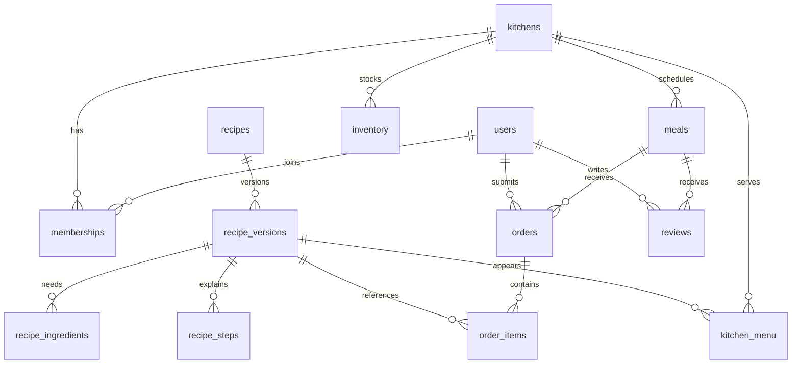

# 关系型存储设计与迁移（schema v2）

## 保存在哪里

共享版仍使用 `data/kitchen.sqlite`，也可通过 `YICAN_DATA_DIR` 指定目录。它现在保存独立的关系型业务表，不再以一个 JSON 字段作为应用数据库。SQLite 无需另装数据库服务，适合当前本机与局域网部署；表结构及约束可作为后续迁移 PostgreSQL 的基础。

SQL 定义：`server/schema.sql`；表与前端类型的映射：`server/relational.ts`；事务入口：`server/store.ts`。已提交的数据以数据库为准，缓存只在事务提交后更新。图片文件仍保存在 `public/images/`，库中保存路径，HowToCook 原文与来源分别保存在菜谱版本的 `source_text`、`source` 列。

## 业务表

| 表 | 主键 / 关联与用途 |
| --- | --- |
| users | 用户 ID 与显示名称；现有体验身份 ID 保留，不引入新的登录流程 |
| kitchens、memberships | 厨房、创建者、主厨和成员角色；同厨房同用户唯一，主厨成员最多一个 |
| recipes、recipe_versions | 稳定菜谱 ID 与具体版本；旧订单始终关联原版本，评价按稳定 ID 汇总 |
| recipe_ingredients、recipe_steps | 每个版本的食材行与步骤行，以版本 ID + position 保序 |
| kitchen_menu | 每间厨房启用的菜谱版本；厨房 + 菜谱唯一，position 保留原菜单顺序 |
| meals、meal_portions | 日期、起止/截止时间、状态及每道菜实际份数；厨房 + 日期 + 餐次名称唯一 |
| orders、order_items | 用户的餐次订单及菜谱明细；每用户每餐最多一单，同单同菜不重复 |
| inventory | 厨房库存数量、单位、食材/调料；厨房 + 名称 + 单位唯一 |
| invitations、meal_grants | 长期/临时邀请与单餐授权；保留有效期与撤销状态 |
| reviews | 厨房、餐次、作者、菜谱版本、稳定菜谱 ID、正文与时间；整餐和单菜分别设唯一索引 |
| mark_groups、recipe_marks | 拿手菜/爱吃的厨房及用户归属与菜谱关联；空分组也保留 |
| shopping_checks | 原勾选键、所属餐次与需求签名，维持需求变化后重新确认的行为 |
| feedback | 原建议和 Bug 记录，与餐后评价分开 |

辅助表：`app_meta` 保存 schema 及同步 revision；`sync_changes` 保存近期增量；`requests` 保存完整的幂等请求回执；`migration_audit` 保存迁移时间、SHA-256 和计数；`state_extensions` 保留未知扩展字段。

旧数据里原本没有的属性、空值、数组顺序和扩展字段都要原样保留。因此实体附带 `shape`（原属性存在性与顺序）、`extra`（仅未知扩展）、`sort_order`（原数组顺序）。它们用于兼容旧前端的 JSON.stringify 编辑指纹；核心业务字段、食材和关联均有独立列/行，不在 extra 中重复保存整条业务对象。

没有强行建立统一食材字典：历史食材存在同义词、不同单位和“适量”等未知数量。此次原样保留名称、单位、数量或 null，避免无依据的合并改变备菜结果。今后可添加可选的标准食材 ID，在人工确认映射后逐步关联。



## 完整性、查询与写入效率

- 开启外键与延迟引用检查，跨表写入一起提交；孤立菜谱引用、重复订单或重复评价导致整个事务回滚，不跳过坏记录。
- 主要索引覆盖成员查厨房、厨房查日历、厨房查库存、菜谱分类、订单历史、菜谱评价历史与邀请有效期。关联表具有外键查找索引；业务排序有独立索引。
- `BEGIN IMMEDIATE` + WAL + `synchronous=FULL` 保留持久化保证，`busy_timeout=5000`；SQLite 同时仅允许一个写入事务。
- 请求 ID 去重、原有 expected 指纹冲突校验继续生效；业务数据、revision、增量、请求结果在一个事务内保存，不产生“前端收到成功但数据未提交”的分步窗口。
- 共享状态以不可变对象缓存。Immer 冻结未变化的子树，只复制发生变化的部分，避免每次改库存都遍历和序列化整个菜谱库。持久化只更新变化的业务行，食材/步骤仅在相应集合变化时重写。
- 重启读取使用按表批量查询和分组重建，避免每道菜单独查询子表。多个 Store 连接通过 revision 检测缓存变化，读取重建处于一致性读事务内。
- 仍保留完整状态 API，兼容已打开的旧页面。新版每 2 秒带 `since` 获取增量；无变化仅返回 revision 和服务器时间（通常不到 100 字节），不再每次发送约 1.44 MB 的实际菜谱状态。
- 断档、落后超过 200 个版本或增量超过 512 KB 时回退全量，避免错误应用更新。同步日志每 100 个版本清理到约最近 2000 个版本；幂等回执暂不自动删除，保留现有重试行为。

## 安全迁移与核对

操作前先停止旧版本服务，避免旧进程在表封存后继续写入。启动新版会自动迁移，也可显式运行：

```sh
npm run backup
npm run db:rehearse
npm run db:migrate
npm run build
npm start
```

`db:rehearse` 通过 SQLite 在线备份 API 生成独立副本，只迁移副本。`db:migrate` 针对当前库；Store 发现旧表时先执行一致性 `VACUUM INTO` 备份，随后在一个事务内建表、导入、读回核对。

核对不是只比较行数：对迁移前的完整状态与从新表重建的完整状态执行 JSON.stringify 后的 SHA-256 比较，包含字段顺序、数组顺序、emoji、空值、未知扩展和完整原文。任何不一致或外键异常均回滚。旧 `requests` 原表保留。报告写入 `data/migration-reports/`，记录库路径、版本、计数、哈希、完整性和外键检查。

迁移成功后旧表改名为 `legacy_kitchen_state`，通过触发器禁止 UPDATE/DELETE。它是迁移时的静态存档，之后的应用读写只使用新表；恢复最新数据不能直接使用该旧快照。

迁移报告中的行数、版本和完整状态哈希由实际输入数据库生成，不使用某台开发电脑的固定值作为验收基线。先在备份副本上演练，报告无差异后再安排实际迁移。

## 回退与备份恢复

1. 停止共享服务，避免导出后还有新写入；先 `npm run backup` 保留最新关系库。
2. `npm run db:export-legacy` 将**当前新表数据和全部回执**导出到新建的 `data/backups/rollback-current-*.sqlite`。导出以读事务获取一致快照并核对哈希，拒绝覆盖已有目标。
3. 仅在已经保留兼容旧 JSON 格式的程序及运行环境时，才把导出文件放到新的恢复目录并用该旧版读取。GitHub 首版不包含早期开发提交，不能按旧开发提交号回退；普通用户使用下一步的一致性备份恢复。保留原关系库，不覆盖原目录。
4. 若继续使用新版，只需将一致性备份复制到新的恢复目录，设置相同环境变量启动。恢复后只读核对 `/api/state` 和完整性。

不要对运行中的 WAL 数据库只复制 `.sqlite` 文件；这样可能遗漏已经提交在 `-wal` 中的记录。正常备份使用 `npm run backup`。数据库备份不包含图片资源，恢复到其他电脑还需带上项目图片目录。

## 压测与边界

运行 `npm run test:load`，只在系统临时目录创建测试库，报告在 `data/load-tests/latest.json`。Node 24.15.0 / Windows，本机回环 HTTP，服务端与压测端为独立进程，HTTP keep-alive；数据库使用真实磁盘、WAL、FULL。模拟 1000 个厨房、1003 条用户记录、600 个菜谱、1000 个餐次、1000 条订单，完整状态约 3.57 MB。保留三个已有体验身份，不能把模拟用户记录说成已经实现 1000 个真实登录账号。

负载为 95% 增量读取 + 5% 原子调整菜品份数，每次写入交替增减，真正触发持久化；所有成功写入均核对 revision 增量。持续压测不含首次全量下载、静态图片和手机渲染。2026-09-20 的最终一次结果：

| 客户端 / 节奏 | 持续时间（含末批完成） | 成功请求/秒 | 成功写入 | 错误 | P95 / P99 |
| --- | --- | ---: | ---: | ---: | --- |
| 100，不间断请求 | 10.03 秒 | 5036.7 | 2525 | 0 | 22 / 25 ms |
| 1000，不间断请求 | 30.32 秒 | 3288.1 | 4985 | 0 | 326.8 / 365.5 ms |
| 1000，每 2 秒请求、错峰进入 | 30.02 秒 | 498.1 | 748 | 0 | 7 / 10.5 ms |

这些结果支持当前数据量下百人/千人在线、以读取为主的混合访问目标，**不代表千次每秒写入、持续数小时稳定性、千台手机同时冷启动或公网性能承诺**。早期测试发现连接建立方式与未冻结状态遍历会造成拒绝连接和明显延迟，最终采用受控长连接、4096 连接等待队列及不可变缓存后按上述负载重新验证，统计吞吐只包含成功请求。

当前仍是单机 SQLite + 单 Node 服务，内存保留整个共享状态，增量也是全局的；随厨房和历史记录无限增长，首次加载、内存和全局增量广播会成为瓶颈。公开上线前应做真实认证、按厨房授权读取、分厨房同步游标、菜谱/订单/评价分页，并将图片交给静态服务。需要多实例写入或超过实测写入负载时，再迁 PostgreSQL、连接池与事务重试；无需重新发明菜谱、订单和评价的实体关系，但 SQL 方言与存储适配仍需实现。

## 只读查看示例

先在线备份，在 SQLite 查看器中打开备份：

```sql
SELECT name, sql FROM sqlite_master WHERE type IN ('table','index') ORDER BY name;
SELECT revision, schema_version FROM app_meta;
SELECT before_hash=after_hash AS lossless, * FROM migration_audit;
PRAGMA integrity_check;
PRAGMA foreign_key_check;

-- 指定厨房某日订单明细
SELECT m.date, m.name AS meal, u.display_name, r.name AS dish, o.note
FROM meals m JOIN orders o ON o.meal_id=m.id
JOIN users u ON u.id=o.user_id
JOIN order_items i ON i.order_id=o.id
JOIN recipe_versions r ON r.id=i.recipe_id
WHERE m.kitchen_id='home' AND m.date='2026-09-19'
ORDER BY m.starts_at,o.sort_order,i.position;

-- 包括自定义炒鸡的食材数量、单位和原始空值
SELECT r.name AS dish,i.name,i.amount,i.unit,i.type
FROM recipe_versions r JOIN recipe_ingredients i ON i.recipe_id=r.id
WHERE r.name LIKE '%临沂炒鸡%' ORDER BY i.position;

-- 最近的整餐与单菜反馈
SELECT m.date,m.name,u.display_name,r.name AS dish,v.text,v.updated_at
FROM reviews v JOIN meals m ON m.id=v.meal_id
JOIN users u ON u.id=v.user_id
LEFT JOIN recipe_versions r ON r.id=v.recipe_id
WHERE v.kitchen_id='home' ORDER BY v.updated_at DESC LIMIT 50;
```

通过界面或 Store 的业务事务修改数据；直接编辑 SQL 既不会自动推进 revision，也可能绕过业务校验和缓存刷新。
