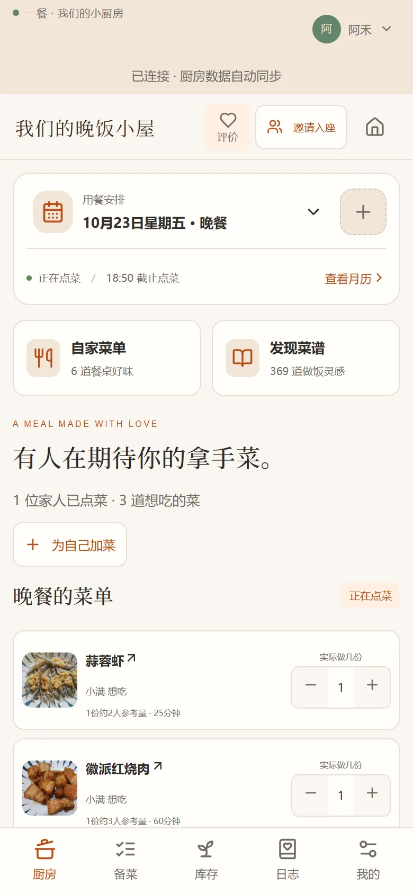
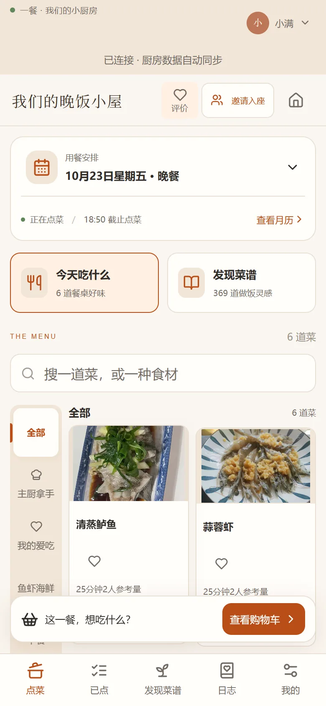
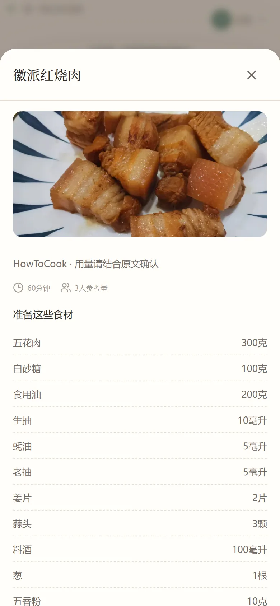
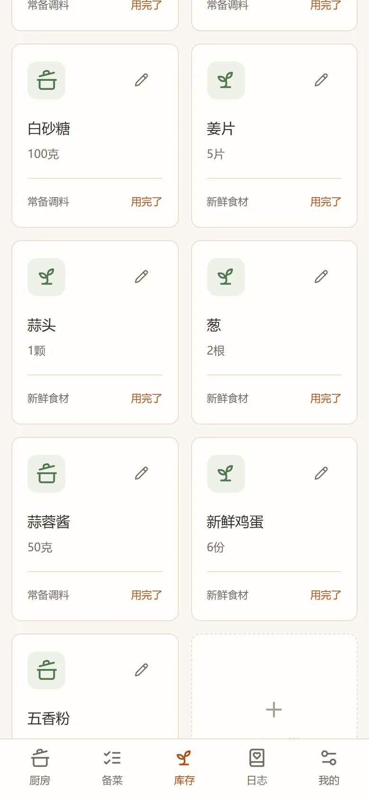

# 一餐使用手册

写给没碰过命令行的人。

不需要懂代码，也不用改任何配置文件。照着往下做，半小时内能让家里人用手机点菜。

中途卡住的话，直接跳到[第十三节](#十三出问题了)，那里按症状列了排查顺序。

<p align="center">
  
</p>

## 一、它长什么样

一餐有三个最常用的页面。

**点菜页**是家里人看到的。今天吃什么、每道菜多久、几个人吃，选好提交。



**备菜页**是主厨看到的。所有点菜合并成一张食材清单，右边告诉你库存够不够。


**日志**记着这个月吃过什么。每顿饭后可以留一句话。


剩下的页面（菜谱、库存、设置）后面会讲到。

## 二、开始之前

需要这几样：

| 东西 | 要求 | 说明 |
| --- | --- | --- |
| 一台电脑 | Windows 10/11，Mac 也行 | 它来当"服务器"，用的时候最好开着 |
| Node.js | 24 或更新 | 运行环境，装一次就好 |
| 同一个 Wi-Fi | 手机和电脑连同一个路由器 | 别用"访客网络"，访客网络一般互相隔离 |
| 手机浏览器 | 系统自带就行 | Chrome、Safari、Edge 都可以 |

不需要买服务器，不需要域名，也不需要装数据库。

> 电脑关机或睡眠后，手机就打不开了。想随时能用，最好找一台常开的旧笔记本，或者在电源设置里关掉自动睡眠。

## 三、先装 Node.js

1. 打开 <https://nodejs.org/>。
2. 下载标着 **LTS** 的那个版本（现在是 24.x），选 Windows 安装包。
3. 双击安装，一路"下一步"，不用改选项。
4. 装完**重启一次电脑**。别省这一步，不然系统可能还找不到新装的程序。

想确认装好了：按 `Win + R`，输入 `cmd` 回车，在黑窗口里输入 `node -v`。显示 `v24` 开头的版本号就对了。

## 四、启动一餐

打开项目文件夹，双击 **`start-lan.cmd`**。

第一次运行会自己做完三件事：

1. 检查 Node.js 版本
2. 安装依赖（要联网，通常 5—10 分钟）
3. 构建页面并启动服务

窗口里会滚过一大段英文，这是正常的。**不要关窗口，也别按键盘。**

> Windows 可能弹出"已保护你的电脑"。点"更多信息"，再点"仍要运行"。这是因为脚本没买数字签名，不是病毒。

成功的话，窗口最后会出现两行：

```
一餐共享服务已启动： http://127.0.0.1:3000
局域网地址：http://192.168.1.23:3000
```

第二行才是手机要用的地址。每个人 `192.168` 后面的数字都不一样，以你窗口里的为准。

`127.0.0.1` 只代表这台电脑自己，手机打不开。窗口关掉，服务就停了。

### 启动失败

| 窗口里显示 | 原因 | 怎么办 |
| --- | --- | --- |
| `Please install Node.js 24 LTS first` | 没装 Node，或装了没重启 | 重装 Node，重启电脑 |
| `Node.js 24 or newer is required` | 版本太旧 | 卸载旧版，装 24 LTS |
| 一直停在安装依赖，或报网络错误 | 依赖没下载下来 | 检查网络，重新双击；公司网络可能拦截，换手机热点试试 |
| `EADDRINUSE` 或"端口被占用" | 3000 端口被别的程序占了 | 见[第十三节](#十三出问题了) |
| 窗口一闪就没 | 多半是 Node 没装好 | 先在 `cmd` 里跑 `node -v` 看看 |

## 五、让手机连上

1. 确认手机和电脑连的是**同一个 Wi-Fi**。
2. 手机浏览器地址栏输入窗口里的局域网地址，比如 `http://192.168.1.23:3000`。
3. 三个细节：要带 `http://`，要带 `:3000`，不要用 `127.0.0.1`。

### 放到手机桌面

以后不用每次输地址。

- **iPhone**：用 Safari 打开，点底部分享按钮，往下找到"添加到主屏幕"。
- **安卓**：用 Chrome 或 Edge 打开，点右上角三个点，选"添加到主屏幕"。

> 现在加的是网页快捷方式，打开后上面还会有地址栏。真正全屏、能离线打开的版本（PWA）还没做，在计划里。

## 六、注册，建一个厨房

第一次打开会看到登录页，点"注册账号"。

| 字段 | 规则 |
| --- | --- |
| 账号 | 3—32 位，只能是字母、数字、点、横线、下划线 |
| 昵称 | 1—18 个字符，不能和别人重名 |
| 密码 | 6—128 位 |

账号可以随便起，拼音就行，比如 `chen`。昵称写家里人怎么叫你。

> **免密码模式别随便开。** 打开之后，任何人只要知道你的账号或昵称就能登录。它只适合完全信任的家人。

注册完会让你创建厨房，并选一个身份：

- **主厨**：管菜单、开饭、看库存和备菜。一个厨房只有一位。
- **点菜主人**：和主厨一起管厨房和邀请，主要点菜。一个厨房只有一位。
- **客人**：点菜和评价。

这里选的只是"常用身份"，用来预选界面。你实际能做什么，取决于你在厨房里的身份。

## 七、邀请另一个人

建好厨房后，点 **「邀请入座」**，会生成一个链接。发给对方就行。

对方打开链接，可以注册新账号，也可以登录已有账号，然后加入。

两种邀请，用途不一样：

| 类型 | 入口 | 有效期 | 适合 |
| --- | --- | --- | --- |
| 长期邀请 | 「邀请入座」 | 7 天 | 家人、室友，长期一起用 |
| 单餐邀请 | 「这一餐相聚」 | 到这一餐结束 | 朋友来吃一顿，只为这顿点菜 |

三个容易踩的坑：

1. **生成链接时，电脑也要用局域网地址打开页面。** 如果用 `127.0.0.1` 打开，链接里就是 `127.0.0.1`，手机点开一定失败。
2. **主人名额只有一个。** 主厨和点菜主人各一位，占满后新成员只能当客人。
3. **邀请 7 天过期。** 过期了重新生成一个就行。

## 八、每天怎么用

一顿饭的流程是这样：

**主厨开饭。** 在「厨房」页点右上角的加号，选日期和午饭/晚饭，可以一次开好几天的。

**家里人点菜。** 打开手机，从菜单里选，可以写备注，比如"番茄炒蛋多一点汤汁"。提交后会进购物车。

**主厨备菜。** 回到「备菜」，看到的是合并后的清单：三道菜都要葱，只会出现一行葱。库存够的会标"已备齐"，不够的写"还缺多少"。

**做饭，吃饭。**

**饭后留一句话。** 在「日志」里给这顿写评价，月历上会留下记录。

页面开着的时候，每 2 秒会自动同步一次；切回页面会立刻同步。

> 保存时如果断网，页面会提示"保存结果尚未确认"，并且保留你输入的内容。网络恢复后重试就行，服务器会按请求编号去重，不会重复提交。

同时改同一样东西时（比如两个人一起改库存），系统会检查版本，避免一个人的修改被另一个人悄悄覆盖。看到冲突提示，刷新一下再改。

## 九、菜谱

内置 369 道菜，来自开源项目 HowToCook。可以搜菜名，也可以按分类翻。


点开一道菜，能看到成品图、时间和食材用量：



每道菜有三种用法：

- **加入菜单**：出现在你家菜单里，可以直接点。
- **另存自家版本**：复制一份，之后随便改，不影响公共菜谱。
- **编辑**：主厨从「我的 → 管理自家菜单」改菜名、食材、步骤。

主厨在「发现菜谱」点击加号加入菜单，再点对号即可移出。移出后恢复加号，需要时可以重新加入；历史用餐记录保留。

### 关于封面

不是每张图都精确对应这道菜。没有标记的是这道菜的成品原图；标了"仅供参考"的是比较接近的参考照片或插画；显示"实拍待补充"的是没找到合适成品图，用了中性占位。

这不是 bug，是刻意的标注。看到"仅供参考"时，别拿它当这道菜的最终样子。

## 十、库存

主厨打开「库存 → 文字录入」，可以直接粘一段话：

```
芹菜一斤，酱油一瓶、猪肉罐头 2份。鸡蛋，10个。香菇
```

系统会当场解析成一张表，保存前可以改。

中英文逗号、顿号、分号、斜杠、竖线或换行都可分项，也可以粘贴带编号的清单。支持「番茄（三个）」「五花肉×2份」「一斤半猪肉」「鸡蛋6枚」等写法；数量与单位都明确时，也可用空格分开多项。不确定的数量会提示修改，例如「猪肉1/2斤」请改为「猪肉半斤」，确认前不会入库。



规则很简单：没写数量的按 1 份算；同一种东西、同一个单位会累加；调料会自动分类。它不会推断保质期，也不会自动扣库存。

> 库存要手动维护。做完饭不会自动扣，吃完记得改，不然下次看到的还是旧数字。

## 十一、账号与安全

点右上角头像，或者「我的 → 我的账号」，可以改密码、切换免密码模式、退出登录。

改密码或切换模式后，其他设备上的旧会话会失效，当前设备继续登录。正常会话有效期 30 天。

**没有找回密码。** 没有邮箱，也没有短信。这是为了不引入邮件服务，让部署保持简单。密码记牢，或者用免密码模式（只在家里用）。真忘了，需要另一位主人帮忙，或者从备份恢复。

「我的 → 厨房与成员管理」可以移除客人、撤销邀请、交接主人身份、解散厨房。主人必须先交接才能退出；解散要输入厨房名字确认。

## 十二、备份与恢复

数据在项目文件夹的 `data/kitchen.sqlite`。账号、密码派生值、厨房、菜单、订单、评价，全在这一个文件里。

### 备份

双击 **`backup-lan.cmd`**，或者运行：

```
npm run backup
```

会在 `data/backups/` 下生成 `kitchen-时间.sqlite`。服务开着也能备份。

> 不要直接复制 `kitchen.sqlite`。数据库开了 WAL，最近的记录可能还在 `-wal` 文件里，只复制主文件会丢数据。

### 恢复

1. 关掉服务窗口，确认服务停了。
2. 把整个 `data` 文件夹改名，比如 `data-旧`。
3. 新建一个空的 `data` 文件夹。
4. 把备份文件放进去，改名成 `kitchen.sqlite`。
5. 重新双击 `start-lan.cmd`。

旧的 `-wal`、`-shm` 不要一起放回来，会和备份对不上。

家里用，一周备份一次就够。更新版本、换电脑、动数据库之前，先备份一次。

## 十三、出问题了

按这个顺序排查，大部分问题前三步就能解决。

### 电脑上也打不开

先看启动窗口还在不在。窗口关了，服务就停了。再看窗口最后几行有没有报错。最后在电脑浏览器打开 `http://127.0.0.1:3000`——能打开说明服务正常，问题在网络。

### 电脑能打开，手机打不开

1. 手机连的是同一个 Wi-Fi 吗？是不是用了流量，或者连了另一个路由器。
2. 是不是访客网络？访客网络一般禁止设备互访。
3. 地址对吗？必须是 `http://192.168.x.x:3000`，不能是 `127.0.0.1`。
4. 电脑的 IP 变了吗？路由器重新分配地址后，旧地址会失效，回窗口看新的。
5. 防火墙拦了吗？项目里附了 `allow-lan.cmd`，右键"以管理员身份运行"，它只放行本地子网的 3000 端口。只在确实需要时运行。

### 昨天还能用，今天不行

多半是电脑重启后 IP 变了，或者电脑睡眠了。看窗口里的新地址，唤醒后等几秒。

### 端口被占用

3000 被别的程序占了。最简单的办法是重启电脑。想换端口，先设环境变量：

```
set YICAN_PORT=3001
start-lan.cmd
```

然后手机访问 `http://192.168.x.x:3001`。

### 页面是旧的

浏览器缓存。电脑上按 `Ctrl + F5` 强制刷新；手机上关掉标签页重新打开。

### 忘了密码

见第十一节，没有找回功能。

### 数据好像少了

先确认看的是不是同一个数据目录。换过目录或改过 `YICAN_DATA_DIR`，数据会在另一个地方。确认后再从 `data/backups/` 恢复。

## 十四、更新和换电脑

### 更新

双击 **`一键更新.cmd`**。需要电脑上装了 [Git](https://git-scm.com/download/win)。

它会先备份数据库，在独立目录里装好新版本，用数据库副本演练一遍，确认没问题才停服切换。失败会回滚，原来的数据不动。

### 换电脑

1. 在旧电脑上备份数据库。
2. 把整个项目文件夹复制到新电脑（`node_modules` 和 `dist` 可以删掉，会重新装）。
3. 把备份放进新电脑的 `data/kitchen.sqlite`。
4. 新电脑装 Node.js 24，双击 `start-lan.cmd`。

> 不要两台电脑同时连同一个数据库文件。一台服务对一个库。

## 十五、会遇到的词

| 词 | 意思 |
| --- | --- |
| 厨房 | 一个独立的用餐空间，有自己的成员、菜单、库存。家里一般只有一个 |
| 主厨 | 管菜单、开饭、看库存的人，一个厨房一位 |
| 点菜主人 | 和主厨一起管厨房和邀请，主要点菜，一个厨房一位 |
| 客人 | 只能点菜和评价的成员 |
| 餐次 | 一顿具体的饭，比如"周三晚餐" |
| 长期邀请 | 7 天有效的加入链接 |
| 单餐邀请 | 只为某一顿饭生成，饭后失效 |
| 库存 | 家里现有的食材，需要手动维护 |
| 备菜 | 把点菜合并成食材清单，对着库存准备 |
| 局域网 | 同一个路由器下的设备组成的网络，比如家里的 Wi-Fi |
| 端口 | 程序在电脑上的"门牌号"，一餐默认用 3000 |
| Node.js | 运行一餐需要的环境，装一次即可 |
| SQLite | 一餐用的数据库，就是一个文件，不用安装 |
| WAL | SQLite 的一种写入方式，所以备份不能直接复制文件 |

## 附：五分钟检查

第一次部署完，照着走一遍：

- [ ] 电脑浏览器打开 `http://127.0.0.1:3000` 正常
- [ ] 手机连同一个 Wi-Fi，打开 `http://192.168.x.x:3000` 正常
- [ ] 注册了第一个账号，创建了厨房
- [ ] 用「邀请入座」让第二个人加入成功
- [ ] 主厨开了一顿饭
- [ ] 第二个人点了一道菜并提交
- [ ] 主厨看到了点菜和合并后的食材
- [ ] 跑了一次 `backup-lan.cmd`，`data/backups/` 里有新文件
- [ ] 关掉窗口再双击 `start-lan.cmd`，数据还在
